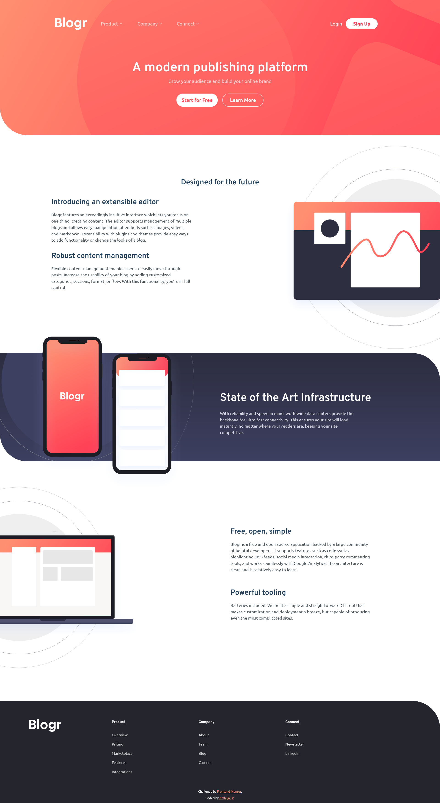
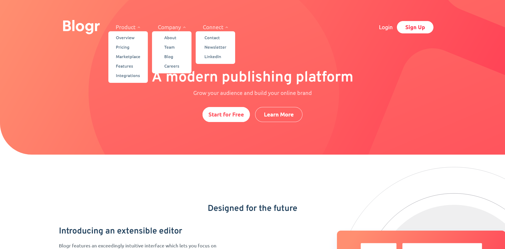
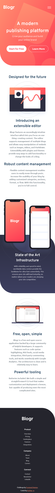
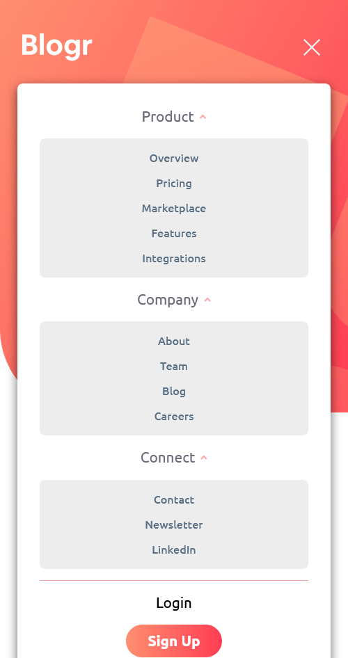

# Frontend Mentor - Blogr landing page solution

This is a solution to the [Blogr landing page challenge on Frontend Mentor](https://www.frontendmentor.io/challenges/blogr-landing-page-EX2RLAApP). Frontend Mentor challenges help you improve your coding skills by building realistic projects. 

## Table of contents

- [Overview](#overview)
  - [The challenge](#the-challenge)
  - [Screenshot](#screenshot)
  - [Links](#links)
- [My process](#my-process)
  - [Built with](#built-with)
  - [Process](#process)
  - [What I learned](#what-i-learned)
  - [Continued development](#continued-development)
  - [Useful resources](#useful-resources)
  - [AI Collaboration](#ai-collaboration)
- [Author](#author)
- [Acknowledgments](#acknowledgments)

## Overview

### The challenge

Users should be able to:

- View the optimal layout for the site depending on their device's screen size
- See hover states for all interactive elements on the page

### Screenshot

preview desktop: 
preview desktop open menu: 

preview mobile: 
preview mobile open menu: 

### Links

- Solution URL: [solution URL](https://github.com/arshiya-sr/frontend-mentor-Blogr-landing-page-Project)
- Live Site URL: [live site URL](https://arshiya-sr.github.io/frontend-mentor-Blogr-landing-page-Project/)

## My process

### Built with

- Semantic HTML5 markup
- CSS custom properties
- Advanced CSS
- Flexbox
- CSS Grid
- Mobile-first workflow
- Media queries
- Deepseek AI

### Process

The build process for this project took a very long time, and that was certainly partly due to the inherent weight of the project itself. Because of its more modern and attractive appearance and some of the relatively simple mechanisms it included, building it was more time-consuming. 

And of course, a project like this made me run into difficulties again when coming up with certain things and forced me to use new methods. 

The overall process was like my previous projects, and I didn't use any special tricks to push the project forward—I just completed a small part of it day by day, piece by piece, until it was finished.

### What I learned

What I learned from this project—in fact, the most important takeaway—was the use of the isolation property. 

By creating a separate wrapper box, you can apply a background to a specific section, like the header or the middle main section, without it bleeding into other parts. This is especially useful considering that its scale is very large and, under normal circumstances, it would overlap with various sections.

### Continued development

debugging and optimization will definitely be done after receiving the Frontend Mentor report and other people's comments and reviews.

And for this project, I'll probably build a tablet layout in the future if I have the time, because I'm not satisfied at all with the transition between mobile and desktop, and the images end up looking weird.

### Useful resources

- [Deepseek AI](https://www.deepseek.com) - DeepSeek has helped me immensely on my learning journey—it's far better to use it for truly understanding concepts than for just getting answers and bypassing the work. And it helped me a lot more on this project.
- [github copilot AI](https://github.com/copilot) - GitHub Copilot has also been a huge help, especially when it comes to coding.
- [freecodecamp free online course](https://www.freecodecamp.org) - I gained my web development knowledge through freeCodeCamp, which is completely free and packed with resources: theory, labs, workshops, quizzes, and even review projects that help you master each topic. This project itself comes from freeCodeCamp, so a big thank-you to them.

### AI Collaboration

- What tools did you use (e.g., ChatGPT, Claude, GitHub Copilot)? i only used deepseek and github copilot AI a lot.
- How did you use them (e.g., debugging, generating boilerplate, brainstorming solutions)? i used it to help me understand the structure and debug small pieces of codes. also github copilot helped me nearly in all of it. It's really good.

## Author

- Github - [my github](https://github.com/arshiya-sr)
- Frontend Mentor - [my frontend mentor](https://www.frontendmentor.io/profile/arshiya-sr)
- freeCodeCamp - [my freecodecamp](https://www.freecodecamp.org/arshiya_sr)

## Acknowledgments

thank to Frontend Mentor for this awesome Project/Challenge, and thank to you for paying your time and attention to my project. I'd be so happy to receive your advice and recommendations.
Hope you a good day ♥